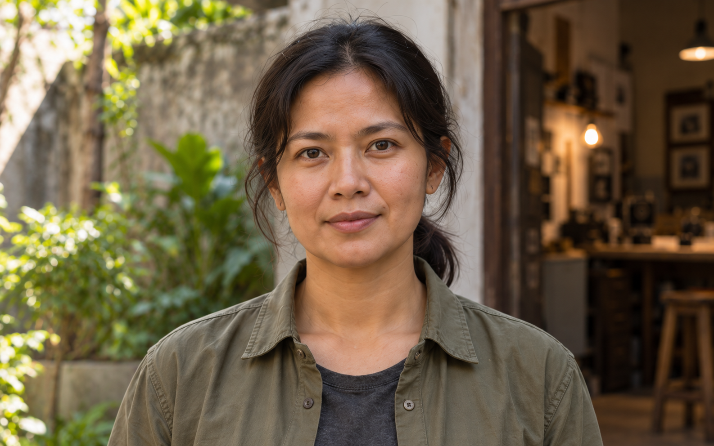
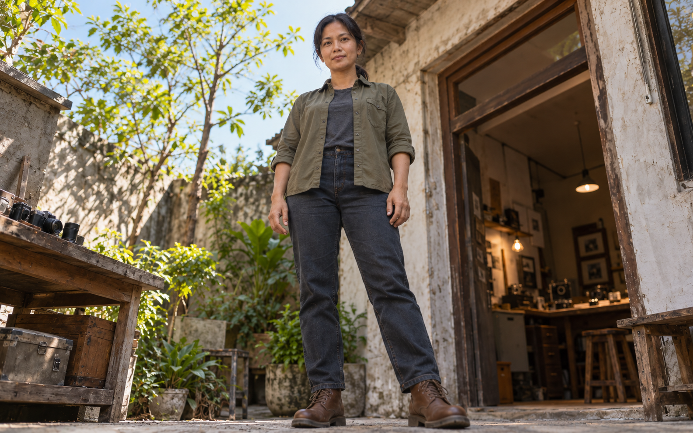
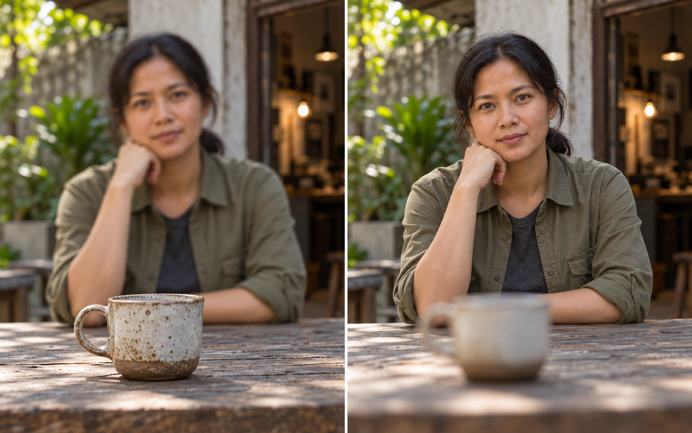
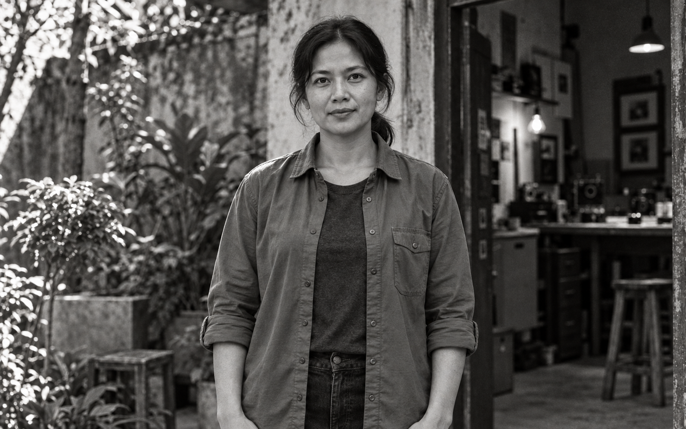
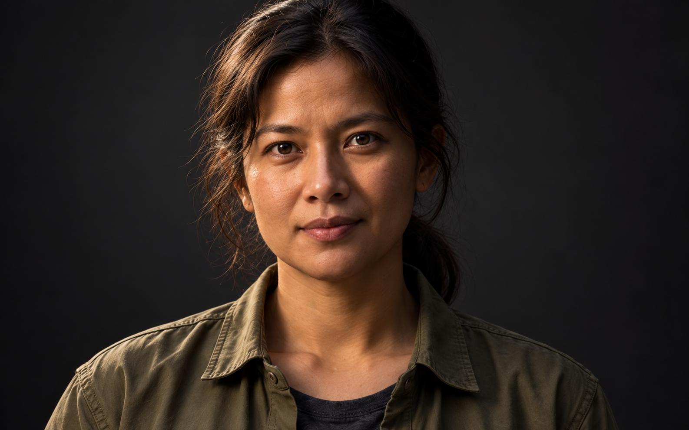
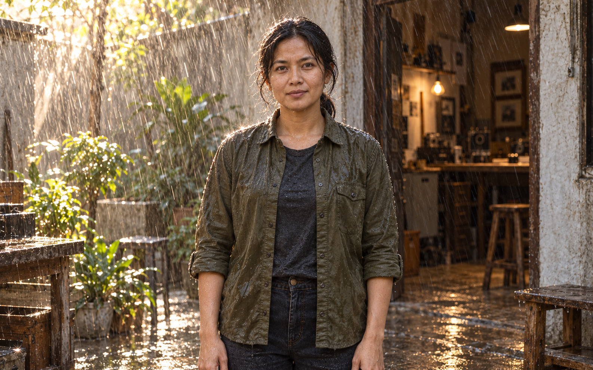

# Flow Filmmaking Skills

Tiga skill untuk merancang produksi video di **Google Flow**, dengan target **Veo 3.1** dan **Gemini Omni Flash 1.1**.

| Skill | Fungsi | Keluaran |
|---|---|---|
| [flow-reference-assets](flow-reference-assets/SKILL.md) | Karakter, properti, set dan frame adegan | Spesifikasi kontinuitas, prompt gambar dan pemetaan referensi |
| [flow-script-shotlist](flow-script-shotlist/SKILL.md) | Pengembangan ide menjadi rencana produksi | Naskah, beat, blocking, shot list, kamera dan suara |
| [flow-video-prompts](flow-video-prompts/SKILL.md) | Prompt siap salin sesuai model dan mode Flow | Prompt visual, focal length, framing, angle, gerak, audio dan negative prompt |

## Cheat sheet cinematic

**[Berkas HTML](flow-video-prompts/assets/cinematic-cheat-sheet.html)** · **[Folder foto](flow-video-prompts/assets/cinematic-imagegen-assets)** · **[Unduh repo sebagai ZIP](https://github.com/anggaagun97/flow-filmmaking-skills/archive/refs/heads/main.zip)**

70 kartu visual: **58 foto ImageGen dengan satu karakter acuan** untuk framing/lensa, angle, depth/fokus, film stock, lighting dan atmosfer; ditambah **12 GIF gerak kamera**. Gerak kamera divisualkan sebagai 12 GIF hasil Google Flow (Omni Flash 1.1, 4 detik) dan ditautkan sebagai file terpisah.

HTML sekitar **30 KB**; semua foto berupa berkas tertaut, bukan data gambar yang disematkan. Untuk memakainya:

1. Clone repo atau pilih **Code → Download ZIP**, lalu ekstrak.
2. Buka `flow-video-prompts/assets/cinematic-cheat-sheet.html` di browser.
3. Pertahankan folder `cinematic-imagegen-assets` dan `cinematic-camera-assets` di samping HTML. Pencarian, pembesaran foto dan salin fragmen bekerja secara lokal.

GitHub menampilkan source HTML, bukan menjalankan halaman interaktifnya. Foto juga dapat dilihat langsung dalam folder atau pratinjau di bawah. Berkas gambar asli berukuran total sekitar 130 MB, sehingga unduhan repo lebih besar daripada HTML-nya. Akses mengikuti visibilitas repo.

| Framing / lensa | Angle | Depth / fokus |
|---|---|---|
|  |  |  |

| Film stock / look | Lighting | Atmosfer |
|---|---|---|
|  |  |  |

Gambar merupakan interpretasi edukatif, bukan simulasi optik atau emulasi film stock terkalibrasi. Prompt pembuatannya tersimpan di [manifest](flow-video-prompts/assets/cinematic-imagegen-assets/generation-manifest.json) dan [koreksi terarah](flow-video-prompts/assets/cinematic-imagegen-assets/refinements.json).

## Aturan produksi

- Character sheet memiliki tiga panel: close-up dengan wajah tajam; full shot depan dengan wajah blur; full shot belakang. Jika sebagian wajah terlihat pada full shot belakang, bagian itu diburamkan. Rambut, tubuh dan pakaian tetap tajam. Blur pada sheet tidak diteruskan ke wajah dalam video.
- Setiap shot list dan prompt video mencantumkan focal length numerik dalam mm dengan acuan full-frame, framing, camera angle dan gerak kamera. Framing juga mempertimbangkan jarak kamera; angka lensa bukan jaminan simulasi optik model.
- Pada frame-to-video, pertahankan viewpoint dan crop frame awal. Pisahkan sheet identitas dari frame adegan.
- Negative prompt menyatakan unsur yang tidak diinginkan. Bila tidak ada field negative yang didukung, masukkan larangan yang jelas ke prompt utama.
- Satu hasil per aset/shot dan tanpa retry otomatis sebagai awal. Jika status MCP ambigu, periksa job, hasil dan saldo sebelum mengulang. Semua percobaan masuk perhitungan biaya.
- Penggabungan klip dilakukan manual oleh pengguna. Ketiga skill menyusun materi dan prompt; eksekusi generasi memerlukan permintaan pengguna tersendiri.

## Standar cinematic dan referensi visual

Setiap prompt video membawa gerak/static camera, focal length + framing + angle, aperture + target fokus + bokeh/DoF, referensi film stock, lighting yang membentuk subjek, dan atmosfer beserta dampaknya. Shot list dan frame adegan meneruskan keputusan yang sama. Sheet identitas tetap netral; aturan tiga panel dipertahankan.

Lihat [pengarahan cinematic](flow-video-prompts/references/cinematic-direction.md) untuk penerapan standar dan batas buktinya. Cheat sheet visual tersedia pada bagian di atas.

Kode slash/no-slash hanya shorthand opsional bila diminta. Prompt lengkap menjadi default; kode tidak dianggap perintah resmi yang menjamin hasil. Pembaruan 30 Oktober 2026 divalidasi secara struktural; belum diuji melalui generasi berbayar.

## Instalasi

1. Clone atau unduh repositori ini.
2. Salin ketiga folder `flow-reference-assets`, `flow-script-shotlist`, dan `flow-video-prompts` ke direktori skill Codex: `$CODEX_HOME/skills`, atau `~/.codex/skills` bila `CODEX_HOME` tidak ditetapkan. Di Windows, lokasi default adalah `%USERPROFILE%\.codex\skills`.
3. Jika folder dengan nama yang sama sudah ada, bandingkan atau cadangkan versi lama sebelum menggantinya.
4. Mulai chat baru atau muat ulang Codex agar daftar skill terbaru terbaca.

Masing-masing folder skill berisi `SKILL.md`, metadata `agents/openai.yaml`, dan referensi pendukung. Ketiga skill dapat dipakai sendiri atau berurutan.

## Contoh pemakaian

```text
Gunakan $flow-reference-assets untuk menyiapkan character sheet tiga
panel, prop sheet amplop, dan set ruang kerja kecil.
```

```text
Gunakan $flow-script-shotlist untuk membuat naskah 30 detik dari aset
tersebut. Sertakan focal length, framing, angle, blocking dan kontinuitas.
```

```text
Gunakan $flow-video-prompts untuk menulis prompt Google Flow dari
shot list tersebut. Gunakan Omni 1.1 Flash, pertahankan kontinuitas,
dan tulis negative prompt yang relevan. Susun prompt saja dahulu.
```

Lihat [panduan lengkap](PANDUAN-TIGA-SKILL.md) untuk pembagian tugas dan alur kerja.

## Dasar metode dan validasi

Disusun dari materi publik berbagai akun edukasi video AI, inspeksi cheat sheet, dokumentasi Google Flow, dan pembelajaran dari satu proyek sampel. Referensi sumber disertakan di setiap skill. Prompt berbayar tersembunyi tidak diekstrak atau dipublikasikan.

Struktur skill, metadata dan tautan lokal diperiksa dengan validator skill-creator. Preferensi tiga panel dengan wajah blur serta tambahan focal length merupakan koreksi setelah uji pertama; revisi tersebut belum diuji ulang lewat generasi. Fitur model dan biaya dapat berubah: periksa UI dan dokumentasi resmi sebelum eksekusi.

Repo ini berisi instruksi skill, panduan dan gambar edukatif ImageGen untuk cheat sheet. Tidak menyertakan arsip halaman sumber, hasil media proyek pengguna, data akun, saldo, kredensial, atau konfigurasi MCP lokal.


### Preview gerak kamera (Google Flow)


GIF lain tersedia di folder `cinematic-camera-assets` dan dipanggil langsung oleh cheat sheet.
